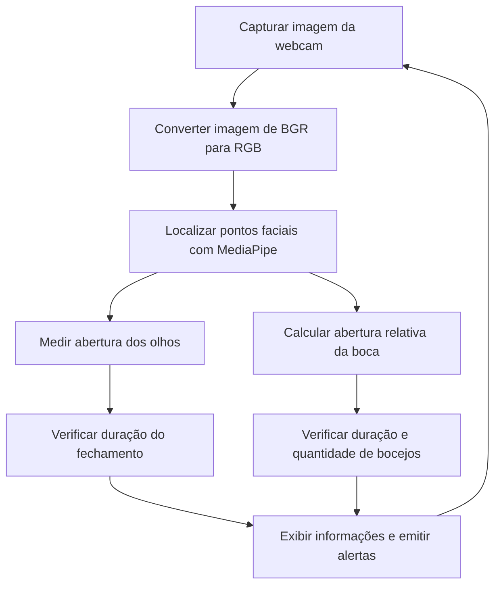

# Detecção de sonolência e fadiga com EAR e MAR

Projeto educacional em Python que utiliza uma webcam e o MediaPipe Face Mesh para acompanhar a abertura dos olhos e da boca, emitindo alertas sonoros em situações associadas à sonolência e ao bocejo.

## 1. Descrição do problema

A sonolência pode reduzir a atenção e o tempo de reação. Alguns sinais visíveis, como o fechamento prolongado dos olhos e a ocorrência de bocejos, podem ajudar a identificar situações que merecem atenção.

Este projeto acompanha dois sinais:

- **Olhos:** fechamento simultâneo por pelo menos 2 segundos.
- **Boca:** abertura prolongada, interpretada como um possível bocejo.

O programa captura imagens da webcam, localiza pontos do rosto e utiliza medidas geométricas e contagem de tempo para decidir quando emitir os alertas.

> Este é um protótipo didático. Ele identifica padrões visuais e não realiza diagnóstico médico nem substitui sistemas de segurança certificados.

## 2. Estratégia de resolução

O processamento é realizado continuamente, quadro a quadro:



### Por que usar o MediaPipe?

O **MediaPipe Face Mesh** estima uma malha de pontos faciais, chamados de *landmarks*. Cada ponto possui um índice, permitindo localizar regiões como pálpebras, lábios e cantos da boca.

Neste projeto, são utilizados apenas alguns desses pontos. Assim, não é necessário treinar uma rede neural própria para reconhecer olhos fechados ou bocejos: o MediaPipe localiza o rosto, e o programa aplica regras geométricas sobre os pontos encontrados.

As coordenadas normalizadas retornadas pelo MediaPipe são convertidas para pixels:

```python
x_pixel = int(landmark.x * largura_imagem)
y_pixel = int(landmark.y * altura_imagem)
```

O OpenCV captura e exibe o vídeo. O NumPy participa do processamento de imagens utilizado pelas bibliotecas, e o cvzone facilita a exibição de textos na tela.

## 3. Olhos: EAR e a simplificação utilizada

O **EAR — Eye Aspect Ratio** relaciona a abertura vertical de um olho à sua largura horizontal.

A figura abaixo representa os seis pontos usados na formulação clássica. Os identificadores P1 a P6 são ilustrativos e não correspondem aos índices do MediaPipe.

**Figura 1 — Distribuição dos pontos no EAR clássico**

```text
                 P2 ●────────● P3
                   ╱          ╲
             P1 ●                ● P4
                   ╲          ╱
                 P6 ●────────● P5

          Pares verticais: P2–P6 e P3–P5
          Par horizontal: P1–P4
```

A fórmula clássica é:

```text
EAR = [d(P2, P6) + d(P3, P5)] / [2 × d(P1, P4)]
```

Nessa expressão, `d(A, B)` representa a distância euclidiana entre dois pontos.

Quando o olho fecha, as distâncias verticais diminuem e o EAR tende a cair.

### O que este código realmente calcula?

Apesar de utilizar a denominação EAR, a implementação atual usa uma **simplificação baseada na distância vertical em pixels**, sem dividir pela largura dos olhos.

Os pontos utilizados são:

| Região | Pálpebra superior | Pálpebra inferior |
|---|---:|---:|
| Olho direito | 159 | 145 |
| Olho esquerdo | 386 | 374 |

As medidas são calculadas com:

```python
distDi = math.hypot(di1x - di2x, di1y - di2y)
distEs = math.hypot(es1x - es2x, es1y - es2y)
```

Os olhos são classificados como fechados quando as duas distâncias são menores ou iguais a `LIMIAR_OLHOS`, cujo valor inicial é **12 pixels**.

Se essa condição durar pelo menos **2 segundos**, o programa:

1. Exibe a mensagem `DORMINDO`.
2. Inicia uma sequência de cinco bipes.
3. Evita novos disparos do alerta de olhos até que eles sejam abertos novamente.

> Como a medida está em pixels, a distância do rosto até a câmera influencia o resultado. Um rosto mais distante pode apresentar medidas menores mesmo com os olhos abertos. O limiar deve ser ajustado nas condições reais de uso.

## 4. Boca: MAR

O **MAR — Mouth Aspect Ratio** relaciona a abertura vertical da boca à sua largura horizontal.

**Figura 2 — Pontos utilizados no cálculo do MAR**

```text
                       ● 13
                       │
                       │ abertura vertical
                       │
          61 ●─────────┼─────────● 291
                       │
                       ● 14

             ← largura horizontal →
```

A figura é esquemática. Os pontos 13 e 14 ficam nos lábios internos; os pontos 61 e 291 ficam nos cantos da boca.

| Medida | Pontos do MediaPipe |
|---|---|
| Abertura vertical | 13 e 14 |
| Largura horizontal | 61 e 291 |

Neste código:

```text
MAR = distância(13, 14) / distância(61, 291)
```

A implementação é:

```python
abertura_boca = math.hypot(bSupx - bInfx, bSupy - bInfy)
largura_boca = math.hypot(bEsqx - bDirx, bEsqy - bDiry)
mar = abertura_boca / largura_boca if largura_boca != 0 else 0
```

Por exemplo, para uma abertura de 36 pixels e uma largura de 60 pixels:

```text
MAR = 36 / 60 = 0,60
```

Por ser uma razão, o MAR reduz a influência da distância até a câmera. Ainda assim, a posição da cabeça e a qualidade dos pontos detectados podem afetar a medida.

### Quando um bocejo é registrado?

A boca é considerada suficientemente aberta quando:

```python
mar >= MAR_LIMIAR
```

O valor inicial de `MAR_LIMIAR` é **0.6**.

Para registrar um bocejo, a boca deve permanecer nessa condição por pelo menos **6 segundos consecutivos**. Se o MAR cair abaixo do limiar antes desse tempo, a contagem é interrompida.

Na versão presente, ao completar 4 segundos:

- O bocejo é registrado.
- Uma sequência de cinco bipes é iniciada.
- O mesmo bocejo não é contado novamente enquanto a boca permanecer aberta.

Para começar a contar outro bocejo, o MAR precisa cair abaixo do limiar e depois voltar a atingir esse valor.

### Como funciona o alerta de fadiga?

Além do alerta individual de bocejo, existe uma regra de acúmulo:

- São necessários **dois bocejos válidos** registrados dentro de uma janela de **60 segundos**.
- O intervalo mínimo entre alertas de fadiga é de **60 segundos**.
- Ao disparar o alerta de fadiga, a lista de bocejos é esvaziada.

A janela considera o instante em que cada bocejo completa os 6 segundos exigidos.

> O intervalo de 60 segundos controla apenas o alerta acumulado de fadiga. Ele não bloqueia os alertas individuais de bocejo nem os alertas de olhos fechados.

## 5. Requisitos e versões

### Ambiente recomendado

Recomenda-se **Windows 10 ou 11**, pois o código utiliza o backend DirectShow para a webcam e o módulo `winsound` para os bipes.

| Componente | Versão recomendada |
|---|---|
| Python | 3.11 |
| NumPy | 1.26.4 |
| MediaPipe | 0.10.21 |
| OpenCV, distribuição `opencv-contrib-python` | 4.11.0.86 |
| cvzone | 1.6.1 |

Essas versões foram selecionadas para manter compatibilidade com a API `mp.solutions.face_mesh` utilizada pelo programa.


## 6. Referências

- [MediaPipe Face Mesh](https://github.com/google-ai-edge/mediapipe/blob/master/docs/solutions/face_mesh.md)
- [OpenCV — documentação](https://docs.opencv.org/4.x/)
- [Python — ambientes virtuais](https://docs.python.org/3/library/venv.html)
- Soukupová, T.; Čech, J. *Real-Time Eye Blink Detection using Facial Landmarks*. Computer Vision Winter Workshop, 2016.
